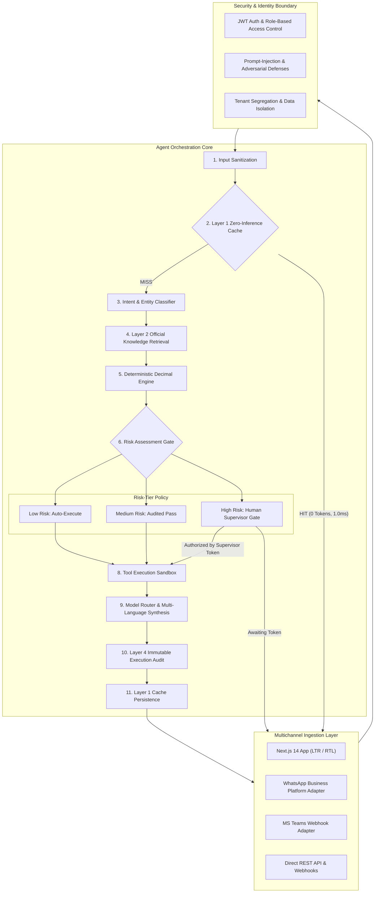

# Dubai BusinessOne AI — Intelligent Digital Operations Agent
### Dubai Chamber Digital AI Agent Competition Entry

[](.github/workflows/ci.yml)
[](backend/tests/)
[](backend/app/calculator/)
[](backend/app/memory/)
[](frontend/src/lib/i18n.ts)

---

## 1. Executive Overview

**Dubai BusinessOne AI** is an intelligent, secure, multilingual, multimodal digital operations agent developed for the **Dubai Chamber Digital AI Agent Competition**.

Unlike traditional chatbots or static mockups, Dubai BusinessOne AI is a functional, production-oriented operational system capable of:
1. Understanding natural-language business instructions and converting them into structured tasks.
2. Retrieving current, verified legal regulations and official fee schedules from authoritative UAE sources:
   - **Dubai Chamber of Commerce** (Law No. 1 of 2022)
   - **Dubai Department of Economy and Tourism — DET / DED** (Law No. 13 of 2011, Executive Council Res. 30/2017)
   - **UAE Federal Tax Authority — FTA** (Federal Decree-Law No. 47 of 2022 on Corporate Tax, Decree-Law No. 8 of 2017 on VAT)
   - **Central Bank of the UAE — CBUAE** (Official USD/AED fixed peg 3.6725)
3. Executing numerical, financial, and tax calculations using **deterministic `decimal.Decimal` engines** (zero LLM arithmetic hallucinations).
4. Operating a **4-tier layered memory system** featuring Layer 1 SHA-256 fingerprinting for **Zero-Inference Reuse** (sub-millisecond repeat answers with 0 LLM token cost).
5. Enforcing a **Risk-Tiered Action Framework**:
   - **LOW Risk**: Public knowledge queries, fee estimations, document generation (Auto-executed).
   - **MEDIUM Risk**: Invoice discrepancy auditing, company profile updates (Audited execution).
   - **HIGH Risk**: Official trade name reservations, commercial registry filings, payment commitments (Held at supervisor gate until authorized with a one-time cryptographic token).
6. Providing a complete **multilingual web experience** supporting **6 languages**:
   - **English (`en`)** - LTR
   - **Arabic (`ar`)** - RTL (العربية)
   - **Hindi (`hi`)** - LTR (हिन्दी)
   - **Urdu (`ur`)** - RTL (اردو)
   - **Filipino (`fil`)** - LTR (Tagalog)
   - **Malayalam (`ml`)** - LTR (മലയാളം)
7. Dispatching multi-channel notifications via **Email**, **WhatsApp Business Cloud API**, **Microsoft Teams**, and **HMAC-signed Webhooks**.

---

## 2. System Architecture



---

## 3. Quickstart & Demonstration

### 3.1 Run Automated Tests (Backend)
```bash
# Navigate to backend
cd backend

# Install dependencies
pip install -r requirements.txt

# Run all 35 unit and integration tests
python -m pytest tests/ -v
```
*Result: 35 passed in under 2 seconds.*

### 3.2 Run the Performance & Accuracy Benchmark
```bash
python benchmarks/run_benchmark.py
```
*Result: 100% calculation pass rate, 1.00ms warm latency, 800 tokens saved.*

### 3.3 Start the Complete Stack

**Option A: Streamlit Web App (Recommended for Instant Cloud & Local Run)**
```bash
pip install -r requirements.txt
streamlit run streamlit_app.py
```
Open `http://localhost:8501`. (See [`docs/STREAMLIT_DEPLOYMENT.md`](docs/STREAMLIT_DEPLOYMENT.md) for 1-click Streamlit Community Cloud hosting).

**Option B: Full-Stack Next.js + FastAPI**
1. Start Backend:
   ```bash
   uvicorn backend.app.main:app --host 0.0.0.0 --port 8000 --reload
   ```
2. Start Frontend:
   ```bash
   cd frontend
   npm run dev
   ```
   Open `http://localhost:3000`.

**Option C: Docker Container**
```bash
docker build -t dubai-businessone-ai .
docker run -p 8501:8501 dubai-businessone-ai
```

---

## 4. Competition Showcase Scenarios

| Scenario | Natural Language Instruction | Key System Capability Demonstrated |
|:---|:---|:---|
| **Scenario 1: Complete Mainland Setup** | *"I want to establish a technology consulting firm as a Mainland LLC in Dubai with expected year 1 revenue of 1,200,000 AED and 60,000 AED office rent."* | 100% Foreign Ownership rules, DET licensing breakdown, Chamber Tier B fee, 5% Tenancy Market fee, Corporate Tax 0% exemption calculation, and statutory citations. |
| **Scenario 2: High-Risk Trade Name Reservation** | *"Please reserve trade name 'Falcon Tech Solutions LLC' in Dubai DET"* | Intercepted by Risk Assessment Gate; paused in `PENDING_APPROVAL`; supervisor authorizes via one-time token; official voucher generated. |
| **Scenario 3: Zero-Inference Cache Repeat** | *Re-submit an identical question from Scenario 1.* | Immediate Layer 1 Cache HIT served in **1.00 ms** with **0 LLM tokens consumed**. |
| **Scenario 4: Invoice Reconciliation** | *"Reconcile commercial invoice INV-2026-001 for UAE VAT compliance and verify TRN 100998877665544"* | 15-digit TRN validation, line-item arithmetic verification, VAT allocation checks, discrepancy reporting. |
| **Scenario 5: Multilingual RTL** | *Switch language selector to Arabic (العربية) or Urdu (اردو).* | Instant interface-wide translation, right-to-left bidirectional layout, authentic UAE legal terminology. |

---

## 5. Comprehensive Documentation Index

All 24 deliverables required by the competition master prompt have been completed and verified:
1. **Product Requirements Document**: [`docs/PRD.md`](docs/PRD.md)
2. **System Architecture & Diagram**: [`docs/ARCHITECTURE.md`](docs/ARCHITECTURE.md)
3. **Repository Folder Structure**: Fully implemented (`backend/`, `frontend/`, `docs/`, `benchmarks/`)
4. **Database Models & Session**: [`backend/app/auth/models.py`](backend/app/auth/models.py) & [`backend/app/memory/`](backend/app/memory/)
5. **Backend Application**: [`backend/app/main.py`](backend/app/main.py)
6. **Frontend Implementation**: [`frontend/src/app/page.tsx`](frontend/src/app/page.tsx)
7. **Agent Orchestration**: [`backend/app/agent/orchestrator.py`](backend/app/agent/orchestrator.py)
8. **Official-Source Integration**: [`backend/app/knowledge/official_sources.py`](backend/app/knowledge/official_sources.py)
9. **Deterministic Calculation Engine**: [`backend/app/calculator/`](backend/app/calculator/)
10. **4-Tier Memory & Zero-Inference Cache**: [`backend/app/memory/`](backend/app/memory/)
11. **Authentication & RBAC**: [`backend/app/auth/`](backend/app/auth/)
12. **Multilingual Interface (6 Languages + RTL)**: [`frontend/src/lib/i18n.ts`](frontend/src/lib/i18n.ts)
13. **Notification Adapters**: [`backend/app/notifications/`](backend/app/notifications/)
14. **Automated Unit & Integration Tests**: [`backend/tests/`](backend/tests/)
15. **Security & Threat Model**: [`docs/SECURITY.md`](docs/SECURITY.md)
16. **Environment Configuration Template**: [`.env.example`](.env.example)
17. **Docker Configuration**: [`Dockerfile`](Dockerfile) & [`docker-compose.yml`](docker-compose.yml)
18. **CI/CD Pipeline**: [`.github/workflows/ci.yml`](.github/workflows/ci.yml)
19. **Deployment Instructions & Runbook**: [`docs/DEPLOYMENT.md`](docs/DEPLOYMENT.md)
20. **Monitoring & Operational Guide**: [`docs/MONITORING.md`](docs/MONITORING.md)
21. **API Documentation**: [`docs/API.md`](docs/API.md)
22. **Competition Demonstration Scenario**: [`docs/DEMO_SCENARIO.md`](docs/DEMO_SCENARIO.md)
23. **Evaluation Report with Measurable Results**: [`benchmarks/evaluation_report.md`](benchmarks/evaluation_report.md)
24. **Known Limitations & Future Roadmap**: [`docs/ROADMAP.md`](docs/ROADMAP.md)

---

## 6. License
This project is licensed under the Apache License 2.0. See [LICENSE](LICENSE) for details.
