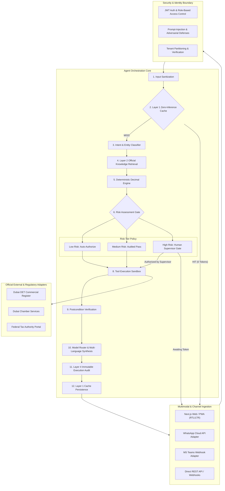

# System Architecture & Technical Specifications
## Dubai BusinessOne AI — Intelligent Digital Operations Agent

---

## 1. Component Layer Details

### 1.1 Ingestion Layer
- **Next.js 14 Web / PWA**: Reactive React 18 interface with native bidirectional support for Left-to-Right (`ltr`) and Right-to-Left (`rtl`) layout rendering.
- **Channel Adapters**:
  - `EmailNotificationAdapter`: SMTP / transactional email dispatcher.
  - `WhatsAppNotificationAdapter`: Meta Cloud API compliant webhook dispatcher.
  - `TeamsNotificationAdapter`: Microsoft Adaptive Card webhook integration.
  - `WebhookNotificationAdapter`: Cryptographically signed HMAC-SHA256 event emitter.

### 1.2 Security & Governance Boundary
- **Password Hashing**: PBKDF2-HMAC-SHA256 with 100,000 rounds and random cryptographic salts.
- **JWT Session Tokens**: Signed tokens enforcing Role-Based Access Control (RBAC): `ADMIN`, `SUPERVISOR`, `OPERATOR`, `VIEWER`.
- **Prompt Injection Defense**: Regex pattern scanning for adversarial directives, system prompt overrides, and unauthorized commands.

### 1.3 Deterministic Calculation Engine
- All math is executed strictly in Python `decimal.Decimal` with statutory `ROUND_HALF_UP` rounding.
- No LLM arithmetic hallucinations are permitted in financial, fee, or tax calculations.
- Full provenance tracking captures mathematical formulas, line-by-line steps, and legal statutory references for every calculation.

### 1.4 4-Tier Memory & Zero-Inference Reuse
- **Layer 1: Exact Answer Cache**: SHA-256 fingerprinting on normalized prompt, tenant ID, and language. Instant zero-token retrieval. Time-sensitive queries (e.g. live account balances) are automatically invalidated within 60 seconds.
- **Layer 2: Verified Knowledge Base**: Curated database of verified official UAE and Dubai legal statutes with freshness indicators.
- **Layer 3: User & Organization Memory**: Securely isolated tenant profile data.
- **Layer 4: Execution History**: Durable store tracking task states, idempotency keys, and supervisor approval tokens.
